# Combat Robot — Kelajak Muhandislari (RoboWar), 2026

A 58 kg spinner-and-wedge combat robot built in two weeks by a New Uzbekistan University team for the **Kelajak Muhandislari** engineering competition (RoboWar category, 70 kg weight limit).

  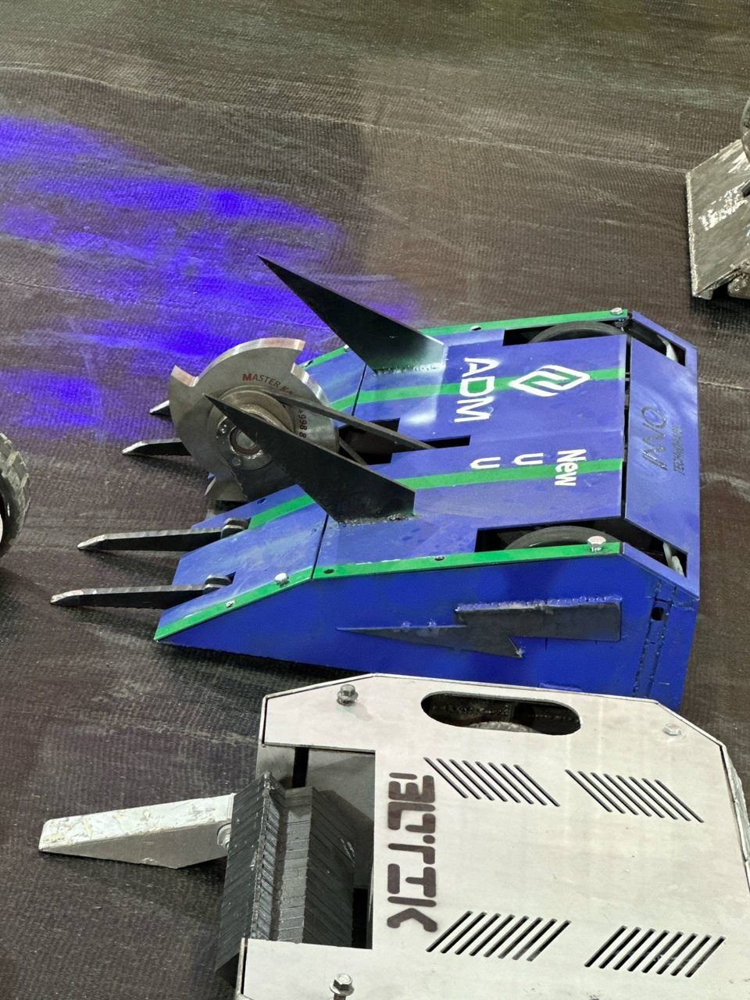

| | |
|---|---|
| **Weight** | ~58 kg (limit 70 kg) |
| **Weapon** | Vertical spinning disc (~8–10 kg), brushless outrunner motor, belt drive |
| **Drive** | DC motor on the rear wheels; front wheels free-rolling |
| **Control** | Futaba 2.4 GHz radio, servos and relays; weapon on an on/off switch |
| **Build time** | 2 weeks |
| **Team** | 4 students, a faculty supervisor, 2 lab engineers |
| **Result** | Lost our fight on points after a weapon-to-weapon hit disabled both spinners |

## My role

Throughout the two-week build I designed and assembled the **electronics** together with one teammate: choosing components, wiring the motors and controllers, and setting up the radio control.

- When the components ordered through the university did not arrive, we **sourced alternatives available in Uzbekistan**, including e-bike motor controllers and throttles.
- After the weapon-system fire the day before the competition (see below), we diagnosed the cause and **rebuilt the electronics overnight**.

## My CAD part: 3D-printed servo bracket

I designed this part in SolidWorks and 3D-printed it. It mounts on a servo so the Futaba radio can control the drive of the rear wheels.

  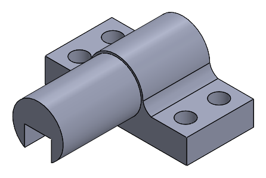

Source file: [`servo-bracket.SLDPRT`](https://github.com/djamalatdinov-cell/combat-robot-robowar/raw/main/cad/servo-bracket.SLDPRT) (SolidWorks part, click to download; open in SolidWorks or eDrawings).

## Credits

- **CAD model:** full-robot SolidWorks assembly by an experienced lab engineer, built around the components we selected.
- **Frame fabrication:** laser cutting and welding by a lab engineer, who taught us the process while we built the electronics.
- **Electronics, wiring, radio control, servo bracket:** student team.
- **Supervisor:** a faculty member who supported the team throughout the build.

  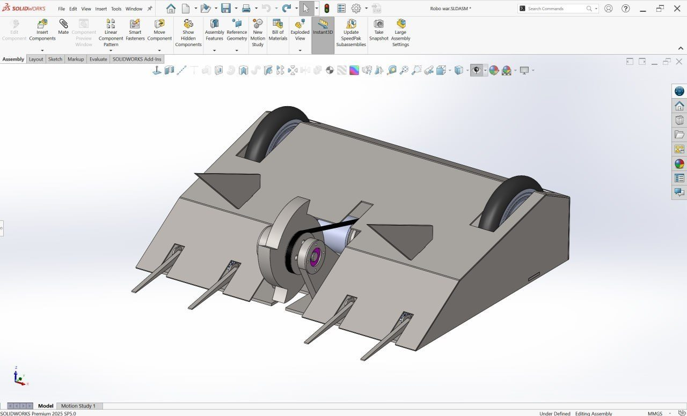
   <em>SolidWorks assembly (CAD by lab engineer).</em>

## Failure analysis: the weapon fire

**What happened.** The first time we spun up the weapon, the day before the competition, the electronics began to spark and smoke. We disconnected the power. When we opened the robot, several wires had melted.

**Root cause.**
1. The motor driver was still at its **default maximum speed of 8,000 rpm**. We had not set a lower limit for the loaded weapon.
2. We assumed the motor would reach that speed with the **8–10 kg weapon attached**. Under that load it could not, so it drew far more current than expected.
3. The locally sourced **wires were undersized for that current** and overheated.

**What we did.** We rebuilt and rewired almost all of the electronics overnight and reached the arena on time.

**What I would do differently.**
- Size every wire from the expected peak current, not from what is available.
- Set speed and current limits on the controller *before* the first powered test.
- Spin up the weapon gradually under load, with a fuse in line, well before the competition.
- Measure current during the first tests instead of assuming the motor's rated speed.

  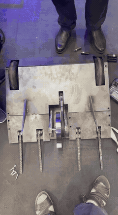
   <em>Weapon spin-up test before the armor was fitted.</em>

## Components (as built)

| | |
|---|---|
| 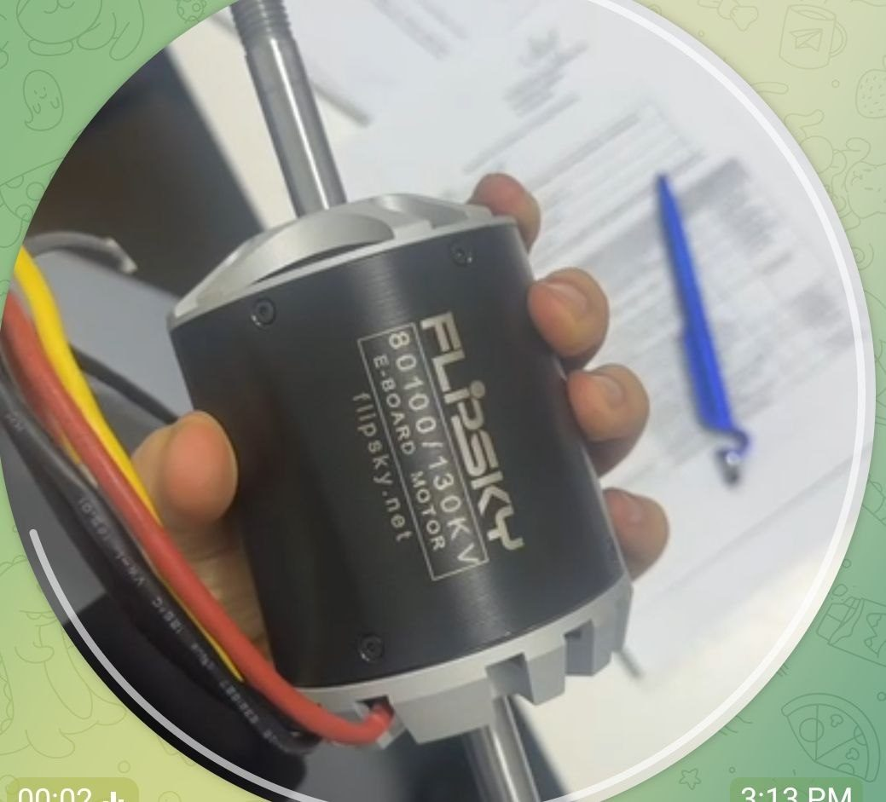 | **Weapon motor:** Flipsky 80100 brushless outrunner |
| 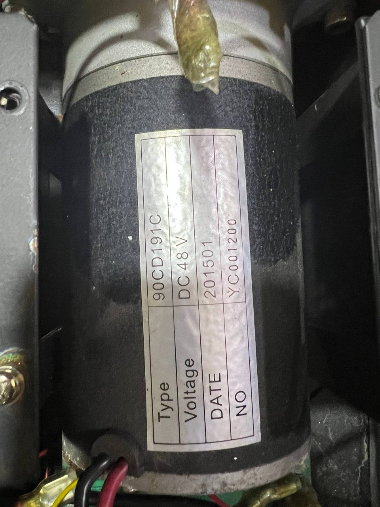 | **Drive motor:** 48 V DC motor |
| 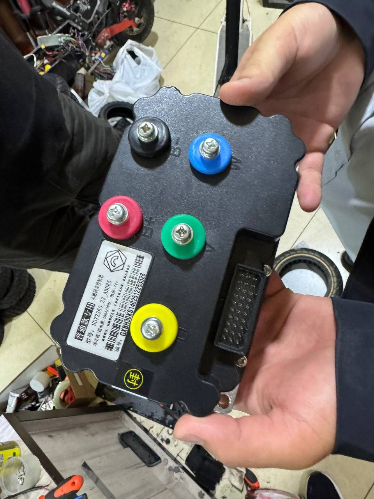 | **Motor controller:** FarDriver |
| 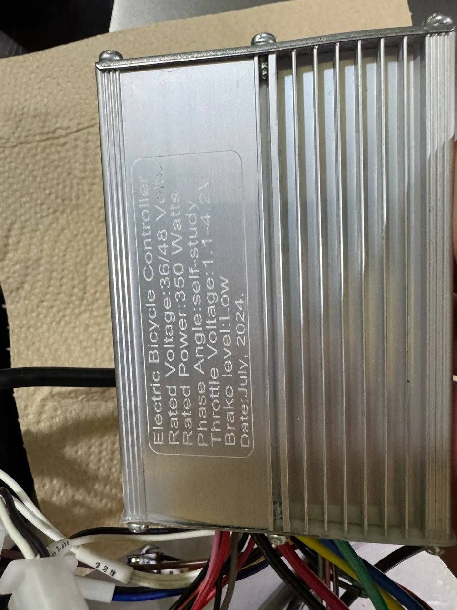 | **Motor controller:** 36/48 V, 350 W e-bike controller (local substitute) |
| 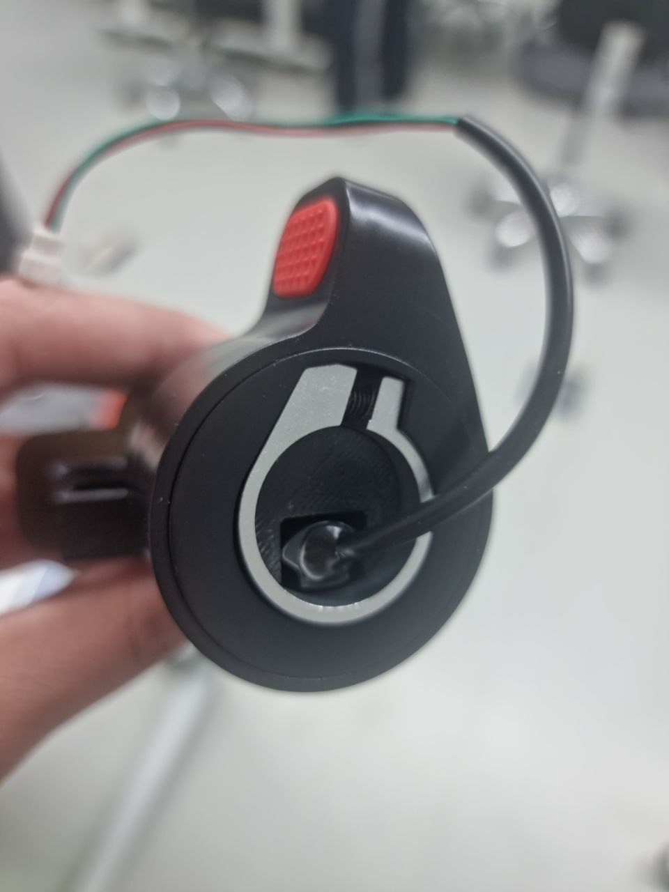 | **Throttle:** e-bike thumb throttle |

### Original plan (bill of materials submitted to the university)

The design called for a belt-driven weapon and dedicated combat-robot electronics. Most of these parts did not arrive in time, so the robot was built with the substitutes above.

| Subsystem | Planned part |
|---|---|
| Weapon motor | MP80100 sensored brushless outrunner, 7 kW |
| Weapon controller | Flycolor X-Cross HV3 ESC, 5–12S, 160 A |
| Weapon battery | 12S 44.4 V 10,000 mAh LiPo, 60C |
| Weapon drive | SPB V-belt with 140 mm / 150 mm pulleys; 30 mm 4140 chromoly dead shaft on 6006/6206 bearings |
| Drive motors | MY1020 24 V 500 W |
| Drive controller | Cytron MDDS30, 80 A |
| Drive battery | 6S 22.2 V 20,000 mAh LiPo, 30C |
| Wiring | 4 AWG and 6 AWG cable; XT90, XT150 and AS150 anti-spark connectors |
| Radio | Futaba 6EX 2.4 GHz |
| Armor / shock absorption | UHMW PE1000 sheet, 20 mm |
| Wheels | Polyurethane, 150 mm diameter, 50 mm wide |

## Build gallery

  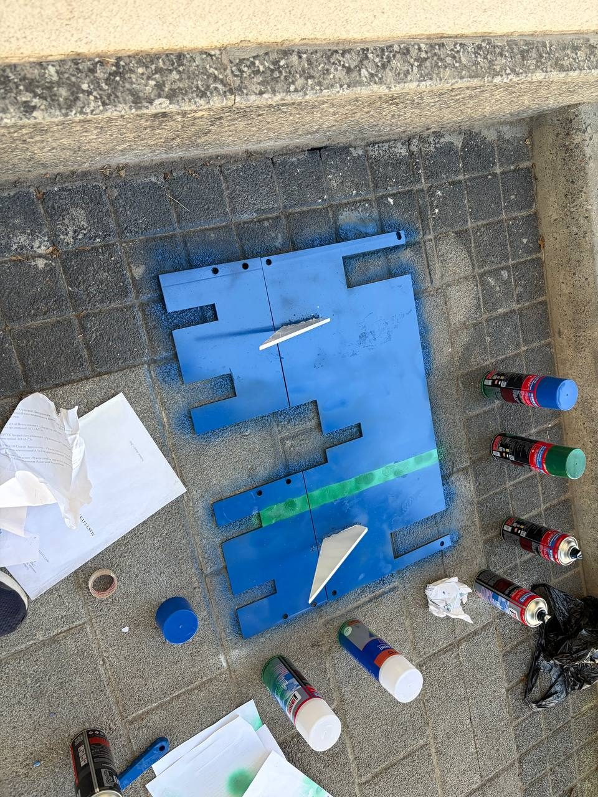
  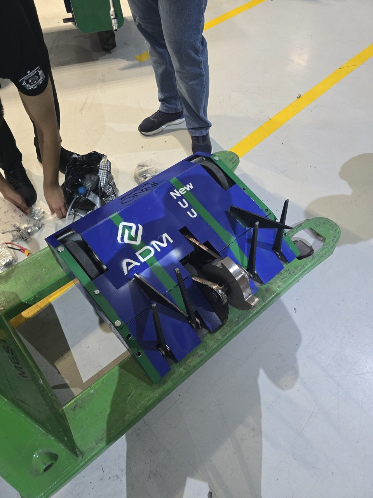

